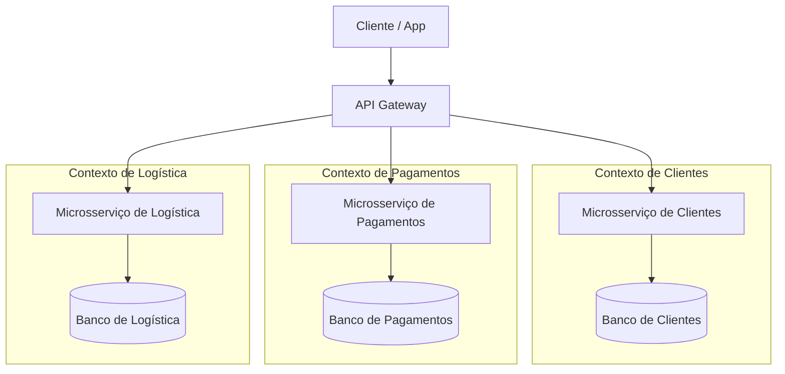

# Laboratório 01: Decomposição de Monolitos e Cloud-Native

**Disciplina:** Engenharia de Backend  
**Professor:** Ronaldo Amaral  
**Aluno:** Valmir Monteiro  
**Matrícula:** 201811250114

---

## Cenário Base: MonolitoShop

O e-commerce **MonolitoShop** roda em um único servidor e compartilha um banco de dados relacional gigante. Com a proximidade de picos de acesso, a equipe de engenharia identificou falhas graves de lentidão e travamentos. Você foi escalado para planejar a modernização arquitetural deste sistema legado.

### Parte 1: Bounded Contexts e Microsserviços (Eixo Y - Decomposição)
Atualmente, a classe `Usuario` no código fonte do monolito possui 45 atributos, misturando dados de login, endereço de entrega, número do cartão de crédito e histórico de navegação no catálogo. O objetivo do Eixo Y é extrair fronteiras de negócio (*Bounded Contexts*) para projetar nossos futuros microsserviços.

**Tarefa 1.1 - Mapeamento:** Separe o sistema em 3 Bounded Contexts principais (ex: Identidade, Pagamentos, Logística) que atuarão como microsserviços independentes. Distribua quais informações da classe "Usuário" legado devem pertencer a cada novo microsserviço.

> **Sua Resposta 1.1:**
> - **Microsserviço 1 (Clientes):** identificador do cliente, nome, e-mail, hash da senha e dados de autenticação. Também pode incluir perfil de preferências e o histórico de navegação para personalização. 
> - **Microsserviço 2 (Pagamentos):** identificador do cliente, tokens dos cartões fornecidos por um provedor de pagamentos e histórico de pagamentos. 
> - **Microsserviço 3 (Logística):** identificador do cliente, destinatário, endereços de entrega, CEP, telefone de contato e informações de envio e rastreamento.

**Tarefa 1.2 - Diagrama de Arquitetura**
Crie um diagrama demonstrando a quebra do monolito nesses 3 novos microsserviços. O diagrama deve ilustrar as fronteiras dos contextos e seus respectivos bancos de dados isolados. (Utilize a sintaxe Mermaid diretamente neste Markdown ou insira o link de uma imagem gerada em ferramentas como draw.io/Lucidchart).

**Sua Resposta 1.2:**

### Parte 2: O Cubo AKF e a Escalabilidade (Eixo X - Clonagem)

Durante os testes de carga, o servidor web atingiu 100% de CPU. A equipe decidiu colocar um *Load Balancer* e subir 3 instâncias idênticas do servidor. No entanto, ao fazer isso, os clientes começaram a reclamar que os itens desapareciam misteriosamente do carrinho de compras a cada clique.

**Tarefa:** Explique por que os itens somem do carrinho ao clonar o servidor (estado) e qual é a solução Cloud-Native (Stateless) para resolver este problema.

> **Sua Resposta:**
> Os itens somem porque o carrinho está armazenado na memória local de uma instância. O balanceador pode encaminhar o próximo clique para outra instância, que não possui aquele carrinho.
>
> A solução é tornar as instâncias **stateless**: salvar o carrinho em um armazenamento externo compartilhado, como Redis com persistência configurada ou um banco de dados, usando o identificador do cliente ou da sessão como chave. Assim, qualquer uma das três instâncias recupera o mesmo carrinho. O estado continua existindo, mas fica fora dos servidores da aplicação, permitindo adicionar ou remover instâncias sem perder os itens.

### Parte 3: Particionamento de Dados (Eixo Z)
O serviço de Pedidos foi extraído com sucesso do monolito, mas seu banco de dados começou a apresentar lentidão devido ao volume massivo de transações originadas de todo o Brasil.

**Tarefa:** Proponha uma estratégia de *Sharding* (particionamento) para o banco de dados de Pedidos. Qual seria a sua chave de partição (Shard Key) e por quê?

> **Sua Resposta:**
> Distribuir os pedidos entre bancos independentes usando **hash do identificador do cliente (`cliente_id`)** como chave de partição. Uma camada de roteamento calcula o hash e direciona as operações ao shard correspondente.
>
> Essa estratégia tende a distribuir os clientes e a carga entre os shards, sem depender da concentração de vendas em determinadas regiões do Brasil. Os pedidos de um mesmo cliente ficam juntos, facilitando consultas.
